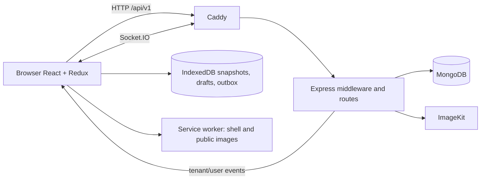
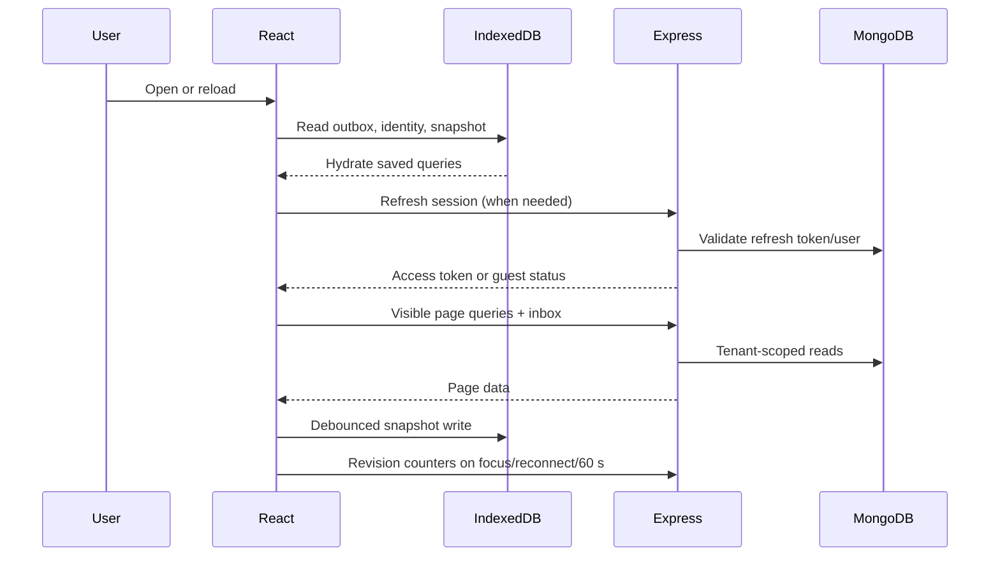
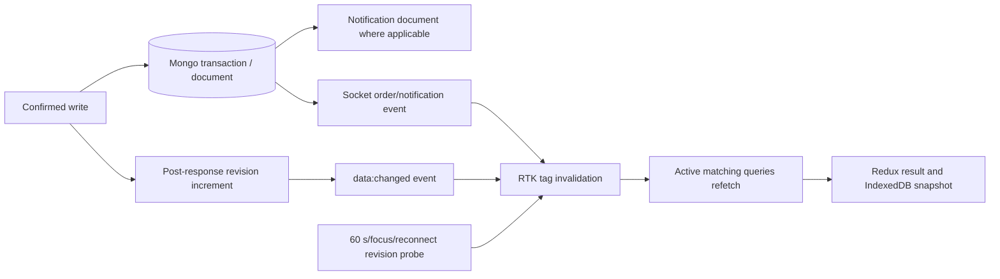

# ECOMSTORE (Smart Kirana) — technical audit

**Audit date:** 28 November 2026. **Repository HEAD:** `0b9a498`. **Scope:** read-only source, configuration, history and local build/test inspection. No production account, database, browser session or performance telemetry was provided. Statements below are labelled **[Code]**, **[Measured locally]**, or **[Unverified]**. Path and line references are relative to this repository and refer to this HEAD. Build artifacts used for measurement were placed in `tmp/audit-dist` and `tmp/audit-build-20261128-fresh`; no application source or production data was changed.

**Repository identity verified:** The audited root is `D:\Backup\DESKTOP\Personal Project\ecomstore_2`; Git HEAD is `0b9a49853b45ae2f843be9d10105492d20eb3eb7`; the package names are `smart-kirana-client` and `smart-kirana-server` (`client/package.json:2`, `server/package.json:2`); and the browser title and startup branding say **Smart Kirana** (`client/index.html:8-21`). The Git remote is `ajaymauryadev/ecomstore`. All source paths and local commands used for this audit were within this repository. No findings came from the separate application.

## 1. Executive summary

The application has a capable core: role permissions, tenant-scoped APIs, transactional billing paths, paginated lists, route splitting and live notifications. The present design also asks a small server and each browser to maintain several overlapping notions of freshness. The browser stores query results in memory and IndexedDB, checks revision counters every minute, listens to sockets, invalidates query tags, and sometimes preloads routes and adjacent data. This can produce extra work and makes “saved” versus “current” hard to interpret. It is **not established** that these mechanisms are the measured cause of the reported slowness; hosted timing and request traces are still required.

The clearest source-confirmed performance risks are an IndexedDB gate before React mounts, a service worker installation that downloads every built chunk, unlimited retention of unused RTK Query entries until a separate 240-query pruning threshold, unanchored regex catalog searches and computed price sorts, and dashboard/report aggregations that process growing transaction sets. The status text “oldest visible snapshot” is literally the minimum timestamp among active cached queries; it does not prove every visible value is old.

**Do first:** capture an authenticated browser waterfall and server timing against a disposable test store, then simplify one freshness path at a time. Keep transactional writes, scoped permissions, socket notification delivery and server authority for stock and money.

## 2. Stack, deployment and modules

| Layer | Current implementation | Evidence |
|---|---|---|
| Frontend | React `^18.2.0`, React Router `^7.18.2`, Vite `^5.0.8`, Redux Toolkit `^2.0.1`, React Redux `^9.0.4`, Tailwind `^3.4.0`, Recharts `^3.8.1`, Socket.IO client `^4.8.4` | `client/package.json`; lockfile pins installed versions |
| Backend | Node `>=20.9.0` (deployment image Node 24), Express `^4.22.3`, Mongoose `^8.24.10`, Socket.IO `^4.8.4`, Helmet, compression, express-rate-limit, JWT, bcrypt, multer, sharp | `server/package.json`, `deploy/northflank/Dockerfile:1-29` |
| Database | MongoDB via one Mongoose connection, max pool 10; 25 model files with tenant IDs, compound indexes, transaction-backed critical flows | `server/src/config/db.js:8-14`, `server/src/models/`, `server/src/utils/transaction.js` |
| Hosting | One container runs Caddy and Node; Caddy serves static assets and proxies API/socket/health on loopback; ImageKit stores images; MongoDB is external | `deploy/northflank/start.sh:4-28`, `deploy/northflank/Caddyfile:7-35`, Dockerfile |
| Client state | Redux `auth`, `cart`, `savedData`, RTK Query `api`; component-local state and IndexedDB snapshots/drafts/outbox | `client/src/app/store.js:11-36`, `client/src/offline/storage.js:1-29` |

The models are ActorSnapshot, AuditLog, Category, Coupon, CouponUsage, DailyClosing, Expense, Notification, Offer, Order, PackingSession, Plan, Product, PurchaseEntry, RefreshToken, Return, StaffActivityLog, StaffSalary, StockLedger, Store, Supplier, SyncRevision, UdharCustomer, UdharEntry and User (`server/src/models/`). Major backend domains map to matching route/controller files: auth, storefront, product/category, order/packing/delivery, POS, stock/inventory, purchases/suppliers, udhar, expenses/salary/closing, reports, notifications, plans/super-admin, audit and backup (`server/src/routes/index.js:33-62`). Frontend feature API modules mirror these domains (`client/src/features/`).

Auth uses access JWT in Redux, rotating refresh cookie, server `protect`, role/permission checks and tenant isolation (`client/src/api/baseApi.js:8-16,111-148`; `server/src/middleware/auth.js`, `roleCheck.js`, `tenantIsolation.js`). Storefront public reads are slug scoped; customers authenticate to one store. Owner, staff, packer and delivery accounts share tenant data according to permissions. Super-admin has platform routes. Every sensitive route still requires inspection when changed; client guards are presentation only (`client/src/App.jsx:91-199`; `server/src/routes/index.js`).



External dependencies include MongoDB, ImageKit and the hosting ingress. No CDN configuration is present in the checked deployment. Caddy provides gzip/zstd and fingerprinted asset caching (`deploy/northflank/Caddyfile:9,22-35`). The 25 November deployment note describes a **draft at that date**, not verified current production state (`deploy/northflank/README.md:9-29`). **[Unverified]** current Northflank allocation, region, CPU, RAM, restarts, MongoDB region and RTT; the user-reported 0.2 vCPU/512 MB remains a hypothesis.

## 3. Startup, navigation and data flow

**Execution order [Code]:** `index.html` loads the Vite entry; `main.jsx:13-31` creates the root and shows `StartupShell`, awaits `loadOutbox`, logout marker, offline identity and scope snapshot reads from IndexedDB (`savedData.js:33-55`), then starts sync listeners, registers the service worker asynchronously, and mounts StrictMode/Redux/Router/App. `AuthInit.jsx:21-75` attempts refresh or pending logout; protected owner/staff/super-admin UI waits for confirmation unless a valid offline identity exists. Public storefront routes can render while refresh is attempted. With a confirmed token, `SocketProvider.jsx:27-53` connects and `savedData.js:308-317` schedules a revision probe. `LiveUpdates.jsx:79-82` invalidates order, notification, packing and current-user tags at socket connect. Workspace warmup preloads at most three permitted route **chunks**, not all business datasets (`workspaceWarmup.js:22-34`). Storefront warmup schedules two queries plus seven route chunks after store readiness (`storefrontWarmup.js:9-24`). The notification bell mounts two reads, unread count and a 20-item inbox (`NotificationBell.jsx:27-30`). Route pages then issue their own RTK Query reads.

For customer `/s/:storeSlug`, the initial path uses the customer layout, store info, category/catalog reads and, where logged in, profile. Owner `/store/dashboard` additionally loads dashboard and notification reads. Staff `/staff/dashboard` similarly loads role-specific dashboard and notification reads. Login changes the session epoch and clears RTK cache before role redirect (`client/src/app/store.js:18-29`); reload repeats IndexedDB restoration and refresh. PWA offline navigation uses cached `index.html` and built chunks, then IndexedDB data where available (`client/offlineShellPlugin.js:8-54`). A never visited view has its code chunk cached after a successful service worker installation, but its business data is absent unless prefetched or previously queried. Offline customer checkout and financial writes need server confirmation; packing has a special queued checklist path.



Routes are lazy loaded via `client/src/App.jsx:1-86` and `client/src/app/routePrefetch.js:3-122`; `StableRoutes` and `RouteContent` preserve the shell. Pointer-over/focus prefetches destination chunk and mapped page queries (`useNavigationPrefetch.js:8-33`); if the pointer has not hovered or code is uncached, the chunk download precedes page render. The route's own query hooks use cached current-key data immediately; first visits show their page-level loading UI. For example, ProductList issues products and categories, plus one adjacent page prefetch when pagination metadata arrives (`ProductList.jsx:103-107`, `useNextPagePrefetch.js:8-25`); OrdersManagement uses an order list and a separate detail read when opened (`OrdersManagement.jsx:93,385`). Most page components mount/unmount on route change while the workspace frame persists. **[Unverified]** flicker, layout shift, unrelated re-renders and actual navigation delay require browser traces for each route; source alone cannot prove them.

### Route and module inventory

| Audience | Routes | Primary data/modules |
|---|---|---|
| Public/customer | `/s/:slug`, `/search`, `/categories`, `/p/:productId`, `/cart`, `/checkout`, `/orders`, `/orders/:id`, `/account`, `/auth` | Storefront, categories, products, cart, profile, orders (`client/src/App.jsx:173-185`) |
| Owner | `/store/dashboard`, `/pos`, `/products` and form, `/categories`, `/suppliers`, `/purchases` and form, `/inventory` and ledger, `/orders` and payment queue, `/packing`, `/deliveries`, `/staff`, `/daily-closing`, `/returns`, `/udhar`, `/expenses`, `/salary`, `/supplier-payments`, `/profit-loss`, `/reports`, `/sales`, `/coupons`, `/offers`, `/settings`, `/notifications`, `/backup`, `/audit-logs` | Matching `client/src/pages/store-owner/` components and `client/src/features/` endpoints (`App.jsx:111-158`) |
| Staff/packer/delivery | `/staff/dashboard`, `/orders`, `/pos`, `/packing`, `/packing/:orderId`, `/deliveries` | Permission-dependent order view, POS, packing, delivery (`App.jsx:160-171`) |
| Super-admin | `/super-admin/dashboard`, `/stores`, `/stores/:id`, `/plans`, `/audit-logs` | Platform admin APIs (`App.jsx:101-109`) |

For all of these, route chunk presence and data cache presence are independent. A changed query argument (search/page/filter/date/store) creates a different RTK Query key. The wrapper in `baseApi.js:215-250` deliberately exposes `currentData` for the exact key and displays loading if no exact-key data exists, which prevents a prior page's data appearing under a new filter but can make pagination/search feel blank before a response. Saved data remains when a same-key refresh runs, subject to page-specific `isError` branches.

## 4. Cache, offline and synchronization architecture

| Layer | Data/key/limit | Refresh, isolation and cleanup |
|---|---|---|
| RTK Query Redux | Endpoint plus serialized args; `keepUnusedDataFor: Infinity` (`baseApi.js:169-175`) | Tags, socket events and revision comparisons; max 240 in-memory entries pruned by custom middleware on read completion (`savedData.js:210-224`); session epoch resets API (`store.js:18-29`) |
| IndexedDB | `smart-kirana-saved-data` stores `snapshots`, `drafts`, `identity`, `outbox` (`storage.js:2-20`); accountScope includes user, role, tenant, store and permissions; snapshot max 240 queries/20 MiB, identity valid 12 h (`storage.js:42-83`) | Debounced 250 ms and idle write; hydrated at boot; logout deletes active identity and previous snapshot (`savedData.js:117-139,185-208`). Draft/outbox treatment is separate. No encryption at rest is implemented in this layer. |
| React/local state | UI filters, forms, scroll and cart; cart draft persistence | Scope-specific draft handling; inspect each form for exact retention requirements (`features/cart/`, `offline/useSavedViewState.js`) |
| Service worker | Entire build output plus shell precached; up to 160 public images (`offlineShellPlugin.js:5-65`) | Versioned shell; new build waits for later activation; no business API cache. Public images are cache-first and can be stale until eviction. |
| HTTP cache | Fingerprinted assets one year immutable; HTML no-cache; authenticated API no-store; public uploads up to 30 days (`Caddyfile:22-35`, `server/src/app.js:42-49,79-89`) | Browser-managed; no CDN in checked config |
| Backend memory | Rate limiter default process memory, pending revision writes and Socket.IO connections | Per-container state, resets on restart (`rateLimiter.js:4-18`, `savedDataSync.js:10-11`) |

`WorkspaceSyncStatus` computes active query timestamps, takes `Math.min`, and calls it “Last synced (oldest visible snapshot)” (`SavedDataStatus.jsx:81-109`). It shows “Showing saved data” for a healthy settled active query and different text for offline, offline identity, unavailable server, 429, pending or failed reads (`:93-99`). A very old active but unrelated query can make the oldest timestamp look alarming while another value is current. This is a **display semantics issue**, not proof that stale data is necessarily being served.

There are two update paths. Socket.IO carries targeted order/notification/packing events and `data:changed` tags; a 75 ms client batch invalidates matching RTK queries (`LiveUpdates.jsx:24-82`). The saved-data revision path increments MongoDB counters **after a successful HTTP mutation response** and emits `data:changed` (`server/src/middleware/savedDataSync.js:34-70`); browser focus, online, initial auth and 60-second interval probe counters (`client/src/offline/savedData.js:242-317`). A missed socket event is recovered at a later revision probe, provided the browser has a valid session and the counter write succeeded. `BroadcastChannel` coordinates session changes between tabs, not business changes (`savedData.js:231-240`). There is no SSE in the checked code. A packing-only offline outbox replays item status with retries and turns 409/authorization failures into conflicts (`offline/packingOutbox.js`); other offline intents preserve drafts but do not silently submit financial writes (`offline/outbox.js`).



The specific flows are: customer checkout writes order/stock/notification records in a transaction, publishes owner/team order and notification events, then owner/staff active order/inbox queries invalidate (`storefront.controller.js:464-574`; `notification.service.js:19-37`; `LiveUpdates.jsx:45-79`). Order status, assignment, payment and packing emit order/packing events and refresh affected tags (`storefront.controller.js:826-1149`; `packing.controller.js:28-35,445-605`). POS sale, purchase, expense, supplier payment and closing use their own write controllers; the generic successful-mutation revision path supplies eventual tag refresh even where no bespoke socket event exists (`pos.controller.js:52-234`; `purchase.controller.js:64-159`; `expense.controller.js:60-145`; `supplier.controller.js:87-93`; `savedDataSync.js:34-70`). Notification reads and mark-read use tenant/user inbox filters; mark-read updates persist before personal revision notification (`notification.controller.js:5-57`). **[Unverified]** end-to-end notification delay, missed events or duplicate transaction rates in live use.

## 5. API and database findings

All HTTP routes are mounted under `/api/v1` (`server/src/app.js:97`, `routes/index.js:33-62`). Public storefront reads and auth endpoints differ from protected tenant APIs. The exact method/path registry is in the route files; the principal request groups and first-load callers are:

| Method/path group | Main caller and purpose | Security / query characteristics |
|---|---|---|
| `POST /auth/refresh`, `GET /auth/me` | startup and identity | Refresh cookie; protected user query; separate auth/live budgets (`auth.routes.js:44-49`) |
| `GET /storefront/:slug`, `/categories`, `/products`, `/products/:id` | public store/catalog | Store slug lookup, category/product queries, count, pagination; regex and computed sort variants (`storefront.routes.js:61-64`, `storefront.controller.js:82-215`) |
| `POST /storefront/:slug/orders`, `GET /.../orders` | checkout/history | Customer auth; transaction and idempotency; list/count (`storefront.routes.js:126-139`, `storefront.controller.js:464-594`) |
| `GET /products`, `GET /products/:id` | owner products and POS | Permission; count plus page, optional populate; POS projection/lean (`product.routes.js:49-52`, `product.controller.js:37-98`) |
| `GET /dashboard`, `/inventory/dashboard`, `/inventory/list` | owner/staff initial view | Permission; aggregate/count/list; inventory search regex (`dashboard.routes.js:9`, `inventory.routes.js:17-19`) |
| `GET /notifications`, `/unread-count`, `PATCH /:id/read` | bell and inbox | Tenant/user filter, list/count; personal revision on writes (`notification.routes.js:11-16`) |
| `GET /sync/revision`, `/storefront/:slug/sync-revision` | initial/focus/minute fallback | Counter reads; no-store (`routes/index.js:33-34`, `savedDataSync.js:13-31`) |
| `GET /reports/*`, `/daily-closing/*`, `/expenses/*`, `/salary/*` | accounting/report routes | Protected; aggregates and paginated records; some additional report limiter (`reports.routes.js:15-29`) |
| `POST /pos/order`, `/packing/*`, `/purchases/*`, `/suppliers/:id/payment` | cash, packing, stock, supplier settlement | Protected permission checks and transaction paths (`pos.routes.js:16-57`, `packing.routes.js:28-73`, `purchase.routes.js:14-40`, `supplier.routes.js`) |

Response bytes, query plans, actual query counts per endpoint and response-time percentiles are **unmeasured**. Source gives lower bounds: product and notification lists each perform page read plus count; dashboard issues seven parallel database operations, including aggregation facets (`dashboard.controller.js:37-91`); checkout and many writes perform multiple reads/writes in transactions. Public category-filtered catalog reads all active category IDs to construct descendants before product/count reads (`storefront.controller.js:132-151`). Cursor pagination exists for some orders; other lists use `skip`, which slows at deep pages (`storefront.controller.js:726-758`, `product.controller.js:84-95`). Search regex across several fields is case insensitive and unanchored, so ordinary B-tree indexes cannot normally bound substring matches (`product.controller.js:42-50`, `storefront.controller.js:125-129`, `inventory.controller.js:83-94`). Product indexes include overlapping prefixes; their actual use and redundancy need `explain('executionStats')` on representative, safely anonymized tenant data (`models/Product.js:148-163`). Notification indexes cover tenant/user and sort paths but owner `$or` still requires explain at realistic volume (`models/Notification.js:25-33`). The Mongo connection pool is 10 (`config/db.js:10-14`); no evidence supports a present exhaustion claim.

### Rate limits and hosting

`apiTrafficLimiter` selects a 200 requests/15 min public IP bucket, a 240 requests/min authenticated business user bucket, or a separate 120 requests/min live-read user bucket for `/auth/me`, revision and notification reads (`rateLimiter.js:20-49`). Refresh has a 60/15 min IP limit, auth attempts 10/15 min IP, plus endpoint-specific payment, reports, POS and upload budgets (`:51-65`). `Retry-After` is returned in the error and the client has cooldown logic (`baseApi.js:42-75,98-165`). Shared IP interference remains possible for anonymous visitors and IP-based auth/upload paths; authenticated business traffic is keyed by user ID. Default in-process limiter memory is not shared between multiple replicas. Proxy trust is loopback CIDR and Caddy substitutes Northflank's external address (`app.js:27`, `Caddyfile:13-19`). **[Unverified]** actual 429 incidence and whether a legitimate session currently exceeds its bucket.

The backend applies security/CORS/rate limit before JSON/cookie/sanitization/compression and route dispatch (`app.js:27-65`). Startup waits for MongoDB, restore readiness and four model initializations before listening (`server/server.js:19-28`); readiness checks more than process liveness (`app.js:99-109`). A small shared CPU could be burdened by simultaneous aggregations, JSON serialization, Caddy, sockets and post-response revision writes. The code includes graceful SIGTERM with a 20-second deadline (`server/server.js:33-47`). CPU throttling, heap, event-loop delay, restarts and region latency are **unmeasured**.

## 6. Local measurements and limits

| Measurement | Result | Environment / meaning |
|---|---|---|
| Vite production build | 10.89 s and 21.35 s wall time in two local runs | Local Windows workspace, installed dependencies; second run used a newly created empty directory, `tmp/audit-build-20261128-fresh`. This is build time, not browser load time. |
| Build output | 1,784,200 bytes total; 1,619,094 bytes JavaScript in 161 `.js` files, uncompressed | Local `Get-ChildItem` summation; HTTP compression and browser transfer differ |
| Largest JS files | PieChart 345,469 B; entry 254,443 B; vendor 173,000 B; Redux 45,097 B; ReportsPage 43,536 B | Local built files, before gzip/brotli |
| Client tests | 36 files / 173 tests passed | Local Vitest; validates tested logic, not production speed |

No honest numeric results are available for cold/warm browser startup, route timings, product search, checkout, notification delivery, p50/p95/p99 API latency, request count/bytes per route, CPU/RAM, LCP/INP/CLS, offline boot, reconnect or 1/5/10/25/50-user throughput. The build and unit tests do not substitute for those measurements. Production was not stress-tested. The server suite also passed locally: 3 files / 164 tests in 76.77 seconds, using its test database setup. These are correctness tests, not performance benchmarks. A staging or disposable local fixture with representative cardinalities is required for controlled concurrency and explain plans.

## 7. Previous optimization history

| Commit | Change still relevant | Current trade-off |
|---|---|---|
| `2c9b871` (25 Nov, “performance”) | Added route/hover prefetch, background scheduler, adjacent-page prefetch, POS/product query/index changes | Better warm navigation, extra chunk/data downloads and cache entries; current scheduler pauses while queries pending (`backgroundTasks.js:8-44`, `queryWarmup.js:3-15`) |
| `493b479` then `429fc56` (26 Nov) | Free-hosting optimization commit was reverted | Do not attribute its removed code to current behavior; inspect diff before resurrecting ideas |
| `29407e3` (26 Nov) | Adjusted dashboard/inventory reads and startup UI, added tests | Source is current; its performance claim is not a new measurement in this audit |
| `bd55bdc`, `f34e38c` (28 Nov) | Notification scopes, revision recovery, saved-query behavior and packing outbox reconciliation | Fixes tested regressions but increases number of freshness and retry paths (`savedData.js`, `LiveUpdates.jsx`, `packingOutbox.js`) |
| `0b9a498` (28 Nov) | Daily-closing change | Financial correctness should be regression-tested before simplifying sync |

The Git history is short (initial commits 23 Nov); no historical production metrics were found. Existing deployment/performance notes were treated as leads and checked against source where possible.

## 8. Significant issues and recommendations

**DS-01 — High — Startup waits on local storage. [Code]** Location: `client/src/main.jsx:13-23`, `client/src/offline/savedData.js:33-55`. Implementation/evidence: `StartupShell` renders, then `initializeSavedData` awaits multiple IndexedDB reads before App mounts. Root cause: offline hydration is part of boot critical path. Impact: any slow or blocked device storage delays navigation and first useful render. Recommendation: measure IDB duration; mount a stable shell/router immediately and let data/auth gates hydrate without serially blocking unrelated public routes. Risk: briefly exposing the wrong scoped snapshot; preserve epoch/scope checks. Verify cold/warm boot with IDB throttling and identity-switch tests.

**DS-02 — High — Service worker installs every built chunk. [Code + measured size]** Location: `client/offlineShellPlugin.js:5-27`. The install list contains every bundle asset, including report/chart chunks; local build has 161 JS files/1.62 MB uncompressed. This spends network, cache and device CPU after first visit and may delay SW readiness on poor connections. Recommendation: precache the shell and high-probability route chunks; cache other public chunks on demand with versioned cleanup, preserving genuinely required offline routes. Risk: unvisited offline screens may not open. Verify first-visit waterfall, install completion and an offline route matrix.

**DS-03 — High — Catalog search/sort cost grows with data. [Code]** Location: `server/src/controllers/product.controller.js:42-50,84-95`, `storefront.controller.js:125-190`, `inventory.controller.js:83-94`. Unanchored regex over multiple fields and computed variant-price aggregation impede index-bounded access; count and skip add work. User impact: product search and category/price pages feel slow as catalog grows. Recommendation: measure representative explain stats, then use a bounded search strategy or normalized indexed search keys; treat price sort separately. Risk: search semantics and order change. Verify identical result sets plus keys/docs examined and p95 at realistic catalog sizes.

**DS-04 — High — Freshness mechanisms can duplicate work. [Code; magnitude unverified]** Location: `client/src/components/shared/LiveUpdates.jsx:24-82`, `client/src/offline/savedData.js:242-317`, `server/src/middleware/savedDataSync.js:34-70`. A mutation may cause RTK invalidation, bespoke socket event, generic `data:changed`, reconnect invalidation and a revision probe. Deduping limits some repeated reads, but active tags can still be invalidated again; post-response revision writes add Mongo work. Recommendation: instrument one order/POS/expense workflow and retain one primary event invalidation plus bounded reconnect revision recovery. Risk: missed-event staleness; verify multi-tab, disconnected/reconnected and out-of-order events.

**DS-05 — Medium — RTK cache and snapshot breadth. [Code]** Location: `client/src/api/baseApi.js:171-175`, `client/src/offline/savedData.js:210-224`, `client/src/offline/storage.js:42-83`. Unlimited unused-entry TTL is governed by custom 240-entry pruning and a 20 MiB snapshot; each successful read can schedule snapshot serialization/write. Impact: browser memory and CPU/IDB activity under many filters/pages. Recommendation: profile actual cache cardinality and snapshot costs, then set domain-specific retention and a smaller saved set based on offline requirements. Risk: loss of instant revisit/offline coverage. Verify heap, IDB write time and revisit timings.

**DS-06 — Medium — The status timestamp can imply broader staleness. [Code]** Location: `client/src/offline/SavedDataStatus.jsx:81-109`. “Oldest visible snapshot” is the oldest active query timestamp; “Showing saved data” is also the normal settled message. Impact: owners may think every number is old and retry unnecessarily. Recommendation: report freshness per visible domain or a clear aggregate plus last successful server confirmation. Risk: simplifying may hide a genuinely failed query; verify mixed fresh/stale/error states.

**DS-07 — Medium — Dashboard/report work has growth risk. [Code; live severity unverified]** Location: `server/src/controllers/dashboard.controller.js:37-91`, `reports.controller.js:232-295,375-471`. Seven parallel dashboard operations include order and variant aggregations; some reports page with skip/count and hydrate documents. Impact: slower dashboard and competition for a 10-connection pool on small compute. Recommendation: use explain and timings first; optimize only dominant pipeline/index/projection and avoid introducing duplicate stored totals prematurely. Risk: incorrect accounting aggregates. Verify totals against ledger/closing fixtures and p95 under concurrent reads.

**DS-08 — Medium — First-time pagination/search can show a blank state. [Code]** Location: `client/src/api/baseApi.js:215-250`, `client/src/pages/store-owner/products/ProductList.jsx:103-107,213-232`. The wrapper only returns `currentData` for exact query args, so a new page/filter lacks content until fetched. This protects correctness but can feel like slow loading. Recommendation: retain stable list container and explicit previous-page context only when labelled as such; do not present old results as matching the new filter. Risk: misleading inventory. Verify page/filter transitions and layout shifts in browser.

**DS-09 — Medium — Rate limiting can constrain shared clients. [Code; incidence unverified]** Location: `server/src/middleware/rateLimiter.js:20-65`. Anonymous and auth/upload budgets are IP based; business reads use per-user buckets and live-read budget. Public customers behind a shared network can collide. Recommendation: collect 429 scope/route counts and compare to normal request traces before changing thresholds; maintain auth abuse protection. Risk: security exposure. Verify 1/5/10 users behind one IP in staging.

**DS-10 — Medium — Offline packing is a complex write path. [Code]** Location: `client/src/offline/packingOutbox.js:27-55,92-156`, `server/src/controllers/packing.controller.js:153-315`. Replay, legacy conflict repair and 409 reconciliation are substantial special-case logic. It may be justified for store operation; current business need is unverified. Recommendation: retain until product usage and conflict metrics are known; document the exact offline contract and keep money/stock server authoritative. Risk: dropping valid queued work or double-applying a checklist action. Verify reconnect, concurrent packers and conflict fixtures.

**DS-11 — Medium — Post-response revision publication is best effort. [Code]** Location: `server/src/middleware/savedDataSync.js:39-70`. Revision increments and generic events run after HTTP response; failure is logged but the user still sees success. Bespoke notifications may still arrive; a missed generic revision can leave other active views stale until a future invalidation. Recommendation: instrument failures and ensure critical changes have durable transaction-linked revision/outbox semantics before relying on revision as correctness signal. Risk: extra transaction contention. Verify injected revision failure/restart with two clients.

**DS-12 — Low — Product index overlap deserves measured review. [Code]** Location: `server/src/models/Product.js:148-163`. Several indexes share tenant/name or tenant/recent prefixes. Extra indexes cost writes and memory, but none can be called redundant without production plans and workload. Recommendation: compare index usage and explain first; remove only proven unused indexes in a separately approved migration. Risk: regressions in rare filters/sorts. Verify equivalent plans and query latencies.

## 9. Consistency, security and concurrency

The checkout path saves notification records inside the order transaction (`notification.service.js:19-37`), and tests cover rollback on notification failure; POS credit and supplier payment tests exercise rollback. The current code uses tenant IDs and permission checks in protected routes, scoped IndexedDB keys, short-lived offline identity and server confirmation for writes. These are strengths. Remaining risks to test are competing stock decrements, simultaneous packing edits, 409 resolution, duplicate HTTP retries, logout with pending outbox, and cross-tenant cache switches. An offline identity is not a server authorization token (`savedData.js:33-55,194-209`). Do not infer live financial correctness from unit tests alone.

## 10. Simplified target and prioritized roadmap

1. **Measure first, no architecture change:** collect one cold/warm owner and customer browser trace on the real free deployment, with request initiators/bytes, React commits, IDB timing, SW install, Web Vitals, API durations, Node CPU/heap/event-loop delay and Mongo explain on sanitized test data. Record current Northflank and MongoDB regions/limits. Use a disposable store for writes and staging for concurrency.
2. **Remove boot contention:** decouple public app shell from IndexedDB reads; test auth/offline identity safety. Reduce service-worker initial precache to the screens actually required offline.
3. **Tune the dominant query:** prioritize catalog regex/price sorts and dashboard/report pipelines according to measured p95 and keys examined. Preserve response contracts and accounting totals.
4. **Choose one freshness owner per domain:** keep Socket.IO for prompt order/notification events, RTK Query for visible data, and a low-cost revision check for reconnect/missed events. Avoid duplicate broad invalidations and saved snapshots for screens that have no offline need.
5. **Validate multi-user behavior:** exercise 1/5/10/25/50 simulated users only in a safe local/staging environment with realistic records; record throughput, p50/p95/p99, errors, 429s and CPU/RAM. Adjust pool/rate limits only with evidence.

Retain role/tenant protections, transactional billing, idempotency, paginated reads, route splitting, targeted socket notifications, explicit offline staleness and user-controlled draft recovery. Simplify full-build precache, indefinite broad query retention, overlapping invalidation paths and status wording after measurements. Expected gains are **directional only**: less first-visit download/IDB CPU, fewer unnecessary reads, steadier navigation and clearer freshness. Potential costs are reduced offline coverage and slower revisits for deliberately uncached views. No percentage or millisecond improvement can be responsibly predicted yet.

## 11. Missing evidence / reproducible next measurements

- Live Northflank dashboard and MongoDB metrics: plan, region, CPU throttling, memory, restarts, connection count, query profiler and log timings.
- Authenticated network/React/Performance traces for every high-traffic route under normal Indian mobile network conditions; include cold and warm cache, offline and reconnect.
- MongoDB `explain('executionStats')` for catalog search/default/price sort, dashboard facets, owner inbox `$or`, orders and reports on a **read-only representative dataset**. No production `explain` was run because no connection was provided.
- Staging 1/5/10/25/50-user runs with representative data; never use production for load generation without explicit permission.
- Compare actual first-load asset transfer to the uncompressed local build; measure service-worker install bytes separately.

This report identifies confirmed code paths and measured local artifacts; it does not claim the application was benchmarked in production.

## Appendix A. Complete HTTP route declaration inventory

The following is a verbatim method/path declaration index from all route files at this HEAD. Prefixes are mounted in the route index file at lines 33-62. Chained method calls inherit the preceding route path. Middleware in each file determines authentication and rate limiting.

```text
server/src/routes\auditLog.routes.js:12:router.get('/', tenantIsolation, requirePermission(PERMISSIONS.AUDIT_LOGS_VIEW), getAuditLogs);
server/src/routes\auditLog.routes.js:13:router.get('/stats', tenantIsolation, requirePermission(PERMISSIONS.AUDIT_LOGS_VIEW), getAuditStats);
server/src/routes\auth.routes.js:44:router.post('/register', requireTrustedOrigin, authLimiter, registerRules, register);
server/src/routes\auth.routes.js:45:router.post('/login', requireTrustedOrigin, authLimiter, loginRules, login);
server/src/routes\auth.routes.js:46:router.post('/refresh', requireTrustedOrigin, refreshLimiter, refreshToken);
server/src/routes\auth.routes.js:47:router.post('/logout', requireTrustedOrigin, logout);
server/src/routes\auth.routes.js:48:router.get('/me', protect, getMe);
server/src/routes\auth.routes.js:49:router.patch('/update-password', requireTrustedOrigin, protect, passwordChangeLimiter, updatePasswordRules, updatePassword);
server/src/routes\backup.routes.js:14:router.get('/full', exportTenant);
server/src/routes\backup.routes.js:15:router.get('/products', exportProducts);
server/src/routes\backup.routes.js:16:router.get('/orders', exportOrders);
server/src/routes\backup.routes.js:17:router.get('/customers', exportCustomers);
server/src/routes\backup.routes.js:18:router.get('/inventory', exportInventory);
server/src/routes\backup.routes.js:19:router.get('/accounting', exportAccounting);
server/src/routes\category.routes.js:17:router.get('/', requirePermission(PERMISSIONS.CATEGORIES_VIEW), getCategories);
server/src/routes\category.routes.js:19:router.post('/', requirePermission(PERMISSIONS.CATEGORIES_MANAGE), [
server/src/routes\category.routes.js:29:router.put('/:id', requirePermission(PERMISSIONS.CATEGORIES_MANAGE), [
server/src/routes\category.routes.js:40:router.delete('/:id', requirePermission(PERMISSIONS.CATEGORIES_MANAGE), deleteCategory);
server/src/routes\category.routes.js:42:router.patch('/reorder', requirePermission(PERMISSIONS.CATEGORIES_MANAGE), [
server/src/routes\coupon.routes.js:31:router.route('/')
server/src/routes\coupon.routes.js:32:  .get(requirePermission(PERMISSIONS.COUPONS_VIEW), getCoupons)
server/src/routes\coupon.routes.js:33:  .post(requirePermission(PERMISSIONS.COUPONS_MANAGE), [
server/src/routes\coupon.routes.js:36:router.route('/:id')
server/src/routes\coupon.routes.js:37:  .put(requirePermission(PERMISSIONS.COUPONS_MANAGE), couponRules, updateCoupon)
server/src/routes\coupon.routes.js:38:  .delete(requirePermission(PERMISSIONS.COUPONS_MANAGE), deleteCoupon);
server/src/routes\dailyClosing.routes.js:33:router.get('/summary', getDailySummary);
server/src/routes\dailyClosing.routes.js:34:router.get('/transactions', getDailyTransactions);
server/src/routes\dailyClosing.routes.js:35:router.post('/', adminOnly, [
server/src/routes\dailyClosing.routes.js:53:router.post('/:id/finalize', adminOnly, [param('id').isMongoId(), version(), body('reviewKey').optional().isHexadecimal().isLength({ min: 64, max: 64 }), validate], finalizeDailyClosing);
server/src/routes\dailyClosing.routes.js:54:router.post('/:id/corrections', adminOnly, [
server/src/routes\dailyClosing.routes.js:61:router.get('/', getDailyClosings);
server/src/routes\dailyClosing.routes.js:62:router.get('/:id', getDailyClosing);
server/src/routes\dashboard.routes.js:9:router.get('/', protect, tenantIsolation, requirePermission(PERMISSIONS.DASHBOARD_VIEW), getDashboard);
server/src/routes\delivery.routes.js:12:router.get('/orders', requirePermission(PERMISSIONS.DELIVERY_VIEW), getDeliveryOrders);
server/src/routes\delivery.routes.js:13:router.patch('/orders/:orderId/status', requirePermission(PERMISSIONS.DELIVERY_UPDATE), [
server/src/routes\index.js:33:router.get('/sync/revision', protect, getSyncRevision);
server/src/routes\index.js:34:router.get('/storefront/:slug/sync-revision', getSyncRevision);
server/src/routes\expense.routes.js:16:router.get('/stats', requirePermission(PERMISSIONS.ACCOUNTING_VIEW), getExpenseStats);
server/src/routes\expense.routes.js:17:router.get('/', requirePermission(PERMISSIONS.ACCOUNTING_VIEW), getExpenses);
server/src/routes\expense.routes.js:32:router.post('/', requirePermission(PERMISSIONS.ACCOUNTING_MANAGE), [
server/src/routes\expense.routes.js:35:router.put('/:id', requirePermission(PERMISSIONS.ACCOUNTING_MANAGE), expenseRules, updateExpense);
server/src/routes\expense.routes.js:36:router.delete('/:id', requirePermission(PERMISSIONS.ACCOUNTING_MANAGE), deleteExpense);
server/src/routes\inventory.routes.js:17:router.get('/dashboard', requirePermission(PERMISSIONS.INVENTORY_VIEW), getInventoryDashboard);
server/src/routes\inventory.routes.js:18:router.get('/list', requirePermission(PERMISSIONS.INVENTORY_VIEW), getInventoryList);
server/src/routes\inventory.routes.js:19:router.get('/low-stock', requirePermission(PERMISSIONS.INVENTORY_VIEW), getLowStockProducts);
server/src/routes\inventory.routes.js:20:router.get('/stock-value', requirePermission(PERMISSIONS.INVENTORY_VIEW), getStockValueReport);
server/src/routes\inventory.routes.js:21:router.post('/adjust', requirePermission(PERMISSIONS.INVENTORY_ADJUST), [
server/src/routes\inventory.routes.js:30:router.get('/ledger/:productId', requirePermission(PERMISSIONS.INVENTORY_VIEW), getStockLedger);
server/src/routes\notification.routes.js:13:router.get('/', getNotifications);
server/src/routes\notification.routes.js:14:router.get('/unread-count', getUnreadCount);
server/src/routes\notification.routes.js:15:router.post('/mark-all-read', markAllRead);
server/src/routes\notification.routes.js:16:router.patch('/:id/read', markRead);
server/src/routes\offer.routes.js:42:router.route('/')
server/src/routes\offer.routes.js:43:  .get(requirePermission(PERMISSIONS.OFFERS_VIEW), getOffers)
server/src/routes\offer.routes.js:44:  .post(requirePermission(PERMISSIONS.OFFERS_MANAGE), [
server/src/routes\offer.routes.js:47:router.route('/:id')
server/src/routes\offer.routes.js:48:  .put(requirePermission(PERMISSIONS.OFFERS_MANAGE), offerRules, updateOffer)
server/src/routes\offer.routes.js:49:  .delete(requirePermission(PERMISSIONS.OFFERS_MANAGE), deleteOffer);
server/src/routes\packing.routes.js:34:router.get('/my-orders', staffRoles, requirePermission(PERMISSIONS.PACKING_VIEW), getMyOrders);
server/src/routes\packing.routes.js:35:router.post('/orders/:orderId/accept', staffRoles, requirePermission(PERMISSIONS.PACKING_PERFORM), [
server/src/routes\packing.routes.js:38:router.get('/session/:orderId', staffRoles, requirePermission(PERMISSIONS.PACKING_VIEW), getPackingSession);
server/src/routes\packing.routes.js:39:router.post('/session/:orderId/start', staffRoles, requirePermission(PERMISSIONS.PACKING_PERFORM), startPackingSession);
server/src/routes\packing.routes.js:40:router.patch('/session/:orderId/item/:itemId', staffRoles, requirePermission(PERMISSIONS.PACKING_PERFORM), [
server/src/routes\packing.routes.js:49:router.post('/session/:orderId/item/:itemId/replacement', staffRoles, requirePermission(PERMISSIONS.PACKING_PERFORM), [
server/src/routes\packing.routes.js:55:router.post('/session/:orderId/complete', staffRoles, requirePermission(PERMISSIONS.PACKING_PERFORM), [
server/src/routes\packing.routes.js:61:router.get('/admin/queue', adminOnly, requirePermission(PERMISSIONS.PACKING_VERIFY), getPackingQueue);
server/src/routes\packing.routes.js:62:router.get('/admin/sessions', adminOnly, requirePermission(PERMISSIONS.PACKING_REPORTS), getStaffPackingSessions);
server/src/routes\packing.routes.js:63:router.get('/admin/session/:sessionId', adminOnly, requirePermission(PERMISSIONS.PACKING_VERIFY), getAdminPackingSession);
server/src/routes\packing.routes.js:64:router.post('/admin/session/:sessionId/verify', adminOnly, requirePermission(PERMISSIONS.PACKING_VERIFY), [
server/src/routes\packing.routes.js:71:router.get('/admin/activity', adminOnly, requirePermission(PERMISSIONS.PACKING_REPORTS), getStaffActivityLogs);
server/src/routes\packing.routes.js:72:router.get('/admin/missing-report', adminOnly, requirePermission(PERMISSIONS.PACKING_REPORTS), getMissingItemsReport);
server/src/routes\packing.routes.js:73:router.get('/admin/high-value-alerts', adminOnly, requirePermission(PERMISSIONS.PACKING_REPORTS), getHighValueAlerts);
server/src/routes\plan.routes.js:12:router.post('/seed', protect, requireRole('super_admin'), seedDefaultPlans);
server/src/routes\plan.routes.js:15:router.get('/', protect, getPlans);
server/src/routes\plan.routes.js:41:router.post('/', [body('name').exists(), body('displayName').exists(), ...planRules], createPlan);
server/src/routes\plan.routes.js:42:router.put('/:id', param('id').isMongoId(), planRules, updatePlan);
server/src/routes\plan.routes.js:43:router.delete('/:id', param('id').isMongoId(), validate, deletePlan);
server/src/routes\pos.routes.js:18:router.post('/order', staffRoles, requirePermission(PERMISSIONS.POS_ACCESS), posLimiter, [
server/src/routes\pos.routes.js:51:router.get('/udhar-customer', staffRoles, requirePermission(PERMISSIONS.POS_ACCESS), [
server/src/routes\pos.routes.js:56:router.get('/orders', staffRoles, requirePermission(PERMISSIONS.POS_ACCESS), getPOSOrders);
server/src/routes\pos.routes.js:57:router.get('/udhar-customers', staffRoles, requirePermission(PERMISSIONS.POS_ACCESS), accountReadLimiter, [
server/src/routes\product.routes.js:49:router.get('/', requirePermission(PERMISSIONS.PRODUCTS_VIEW), getProducts);
server/src/routes\product.routes.js:50:router.get('/import/sample', requirePermission(PERMISSIONS.PRODUCTS_CREATE), downloadProductSample);
server/src/routes\product.routes.js:51:router.post('/import', requirePermission(PERMISSIONS.PRODUCTS_CREATE), uploadProductWorkbook, importProducts);
server/src/routes\product.routes.js:52:router.get('/:id', requirePermission(PERMISSIONS.PRODUCTS_VIEW), getProduct);
server/src/routes\product.routes.js:53:router.post('/', requirePermission(PERMISSIONS.PRODUCTS_CREATE), productRules, createProduct);
server/src/routes\product.routes.js:54:router.put('/:id', requirePermission(PERMISSIONS.PRODUCTS_EDIT), [
server/src/routes\product.routes.js:85:router.delete('/:id', requirePermission(PERMISSIONS.PRODUCTS_DELETE), deleteProduct);
server/src/routes\product.routes.js:86:router.patch('/:id/toggle/:field', requirePermission(PERMISSIONS.PRODUCTS_EDIT), toggleProductField);
server/src/routes\product.routes.js:87:router.patch('/:id/variants/:variantId/stock', requirePermission(PERMISSIONS.INVENTORY_ADJUST), [
server/src/routes\product.routes.js:92:router.post('/bulk/prices', requirePermission(PERMISSIONS.PRODUCTS_EDIT), [
server/src/routes\reports.routes.js:17:router.get('/profit-loss', getProfitLoss);
server/src/routes\reports.routes.js:18:router.get('/daily-sales', getDailySales);
server/src/routes\reports.routes.js:19:router.get('/sales-overview', reportReadLimiter, getSalesOverview);
server/src/routes\reports.routes.js:20:router.get('/monthly-sales', getMonthlySales);
server/src/routes\reports.routes.js:21:router.get('/yearly-sales', getYearlySales);
server/src/routes\reports.routes.js:22:router.get('/product-sales', getProductSales);
server/src/routes\reports.routes.js:23:router.get('/category-sales', getCategorySales);
server/src/routes\reports.routes.js:24:router.get('/stock', getStockReport);
server/src/routes\reports.routes.js:25:router.get('/supplier-dues', getSupplierDues);
server/src/routes\reports.routes.js:26:router.get('/customer-dues', getCustomerDues);
server/src/routes\reports.routes.js:27:router.get('/expenses', getExpenseReport);
server/src/routes\reports.routes.js:28:router.get('/salary', getSalaryReport);
server/src/routes\reports.routes.js:29:router.get('/purchases', getPurchaseReport);
server/src/routes\purchase.routes.js:16:router.route('/')
server/src/routes\purchase.routes.js:17:  .get(requirePermission(PERMISSIONS.PURCHASES_VIEW), getPurchases)
server/src/routes\purchase.routes.js:18:  .post(requirePermission(PERMISSIONS.PURCHASES_MANAGE), [
server/src/routes\purchase.routes.js:35:router.get('/stats', requirePermission(PERMISSIONS.PURCHASES_VIEW), getPurchaseStats);
server/src/routes\purchase.routes.js:37:router.route('/:id')
server/src/routes\purchase.routes.js:38:  .get(requirePermission(PERMISSIONS.PURCHASES_VIEW), getPurchase);
server/src/routes\purchase.routes.js:40:router.post('/:id/payment', requirePermission(PERMISSIONS.PURCHASES_PAY), [
server/src/routes\return.routes.js:22:router.get('/stats', adminOnly, requirePermission(PERMISSIONS.RETURNS_PROCESS), getReturnStats);
server/src/routes\return.routes.js:23:router.get('/', staffRoles, requirePermission(PERMISSIONS.RETURNS_VIEW), getReturns);
server/src/routes\return.routes.js:24:router.post('/', staffRoles, requirePermission(PERMISSIONS.RETURNS_CREATE), [
server/src/routes\return.routes.js:45:router.get('/:id', staffRoles, requirePermission(PERMISSIONS.RETURNS_VIEW), getReturn);
server/src/routes\return.routes.js:46:router.post('/:id/process', adminOnly, requirePermission(PERMISSIONS.RETURNS_PROCESS), [
server/src/routes\salary.routes.js:16:router.get('/staff', requirePermission(PERMISSIONS.SALARY_VIEW), getStaffList);
server/src/routes\salary.routes.js:17:router.get('/stats', requirePermission(PERMISSIONS.SALARY_VIEW), getSalaryStats);
server/src/routes\salary.routes.js:18:router.get('/history/:staffId', requirePermission(PERMISSIONS.SALARY_VIEW), getStaffSalaryHistory);
server/src/routes\salary.routes.js:19:router.get('/', requirePermission(PERMISSIONS.SALARY_VIEW), getSalaryRecords);
server/src/routes\salary.routes.js:20:router.post('/', requirePermission(PERMISSIONS.SALARY_MANAGE), [
server/src/routes\salary.routes.js:27:router.post('/:id/payment', requirePermission(PERMISSIONS.SALARY_MANAGE), [
server/src/routes\store.routes.js:21:router.get('/public/:slug', getStoreBySlug);
server/src/routes\store.routes.js:27:router.get('/', requireRole('super_admin'), getAllStores);
server/src/routes\store.routes.js:28:router.get('/stats', requireRole('super_admin'), getStoreStats);
server/src/routes\store.routes.js:29:router.patch('/:id/toggle-status', requireRole('super_admin'), toggleStoreStatus);
server/src/routes\store.routes.js:32:router.get('/mine', tenantIsolation, requireAnyPermission(PERMISSIONS.DASHBOARD_VIEW), getMyStore);
server/src/routes\store.routes.js:33:router.patch('/mine', tenantIsolation, requirePermission(PERMISSIONS.SETTINGS_MANAGE), [
server/src/routes\storefront.routes.js:61:router.get('/:slug', getStorefrontInfo);
server/src/routes\storefront.routes.js:62:router.get('/:slug/categories', getStorefrontCategories);
server/src/routes\storefront.routes.js:63:router.get('/:slug/products', getStorefrontProducts);
server/src/routes\storefront.routes.js:64:router.get('/:slug/products/:productId', getStorefrontProduct);
server/src/routes\storefront.routes.js:65:router.post('/:slug/cart/products', [
server/src/routes\storefront.routes.js:72:router.post('/:slug/auth/register', requireTrustedOrigin, authLimiter, [
server/src/routes\storefront.routes.js:79:router.post('/:slug/auth/login', requireTrustedOrigin, authLimiter, [
server/src/routes\storefront.routes.js:96:router.post('/:slug/coupon/validate', optionalAuth, [
server/src/routes\storefront.routes.js:104:router.get('/:slug/customer/profile', getCustomerProfile);
server/src/routes\storefront.routes.js:105:router.put('/:slug/customer/profile', [
server/src/routes\storefront.routes.js:110:router.post('/:slug/customer/addresses', [
server/src/routes\storefront.routes.js:121:router.delete('/:slug/customer/addresses/:addressId', deleteAddress);
server/src/routes\storefront.routes.js:122:router.post('/:slug/customer/favorites', [body('productId').isMongoId(), validate], toggleFavorite);
server/src/routes\storefront.routes.js:123:router.get('/:slug/customer/favorites', getFavorites);
server/src/routes\storefront.routes.js:126:router.post('/:slug/orders', protect, requireRole('customer'), [
server/src/routes\storefront.routes.js:138:router.get('/:slug/orders', protect, requireRole('customer'), requireCustomerStore, getOrders);
server/src/routes\storefront.routes.js:139:router.get('/:slug/orders/:orderId', optionalAuth, requireCustomerOrderAccess, getOrder);
server/src/routes\storefront.routes.js:140:router.post('/:slug/orders/:orderId/cancel', optionalAuth, requireCustomerOrderAccess, [
server/src/routes\storefront.routes.js:146:router.post(
server/src/routes\storefront.routes.js:157:router.get(
server/src/routes\storefront.routes.js:165:router.get('/:slug/admin/orders/payment-queue', ...adminAuth, requirePermission(PERMISSIONS.ORDERS_PAYMENT_VERIFY), getPaymentQueue);
server/src/routes\storefront.routes.js:168:router.get('/:slug/admin/orders/:orderId', ...adminAuth, getAdminOrder);
server/src/routes\storefront.routes.js:169:router.get('/:slug/admin/orders/:orderId/payments', ...adminAuth, getAdminOrderPayments);
server/src/routes\storefront.routes.js:170:router.get(
server/src/routes\storefront.routes.js:178:router.get('/:slug/admin/orders', ...adminAuth, getAdminOrders);
server/src/routes\storefront.routes.js:181:router.patch('/:slug/admin/orders/:orderId/status', ...adminAuth, requirePermission(PERMISSIONS.ORDERS_STATUS_UPDATE), [
server/src/routes\storefront.routes.js:187:router.post('/:slug/admin/orders/:orderId/cancel', ...adminAuth, requirePermission(PERMISSIONS.ORDERS_CANCEL), reasonRules, adminCancelOrder);
server/src/routes\storefront.routes.js:188:router.post('/:slug/admin/orders/:orderId/reject', ...adminAuth, requirePermission(PERMISSIONS.ORDERS_REJECT), reasonRules, rejectOrder);
server/src/routes\storefront.routes.js:189:router.post('/:slug/admin/orders/:orderId/partial', ...adminAuth, requirePermission(PERMISSIONS.ORDERS_PARTIAL_FULFILL), [
server/src/routes\storefront.routes.js:196:router.patch('/:slug/admin/orders/:orderId/assign', ...adminAuth, requirePermission(PERMISSIONS.ORDERS_ASSIGN), [
server/src/routes\storefront.routes.js:200:router.patch('/:slug/admin/orders/:orderId/assign-delivery', ...adminAuth, requirePermission(PERMISSIONS.ORDERS_ASSIGN), [
server/src/routes\storefront.routes.js:204:router.post('/:slug/admin/orders/:orderId/payment/verify', ...adminAuth, requirePermission(PERMISSIONS.ORDERS_PAYMENT_VERIFY), [
server/src/routes\superAdmin.routes.js:16:router.get('/stats', getSystemStats);
server/src/routes\superAdmin.routes.js:17:router.get('/stores', getStores);
server/src/routes\superAdmin.routes.js:18:router.post('/stores', [
server/src/routes\superAdmin.routes.js:28:router.get('/stores/:id', getStoreDetail);
server/src/routes\superAdmin.routes.js:29:router.patch('/stores/:id/subscription', [
server/src/routes\superAdmin.routes.js:36:router.patch('/stores/:id/toggle', toggleStoreStatus);
server/src/routes\superAdmin.routes.js:37:router.patch('/stores/:id/modules', [
server/src/routes\superAdmin.routes.js:42:router.patch('/stores/:id/limits', [
server/src/routes\superAdmin.routes.js:49:router.post('/stores/:id/support-access', [
server/src/routes\superAdmin.routes.js:53:router.get('/stores/:id/support-access', getSupportAccessLogs);
server/src/routes\superAdmin.routes.js:54:router.get('/audit-logs', getAuditLogs);
server/src/routes\supplier.routes.js:27:router.route('/')
server/src/routes\supplier.routes.js:28:  .get(requirePermission(PERMISSIONS.SUPPLIERS_VIEW), getSuppliers)
server/src/routes\supplier.routes.js:29:  .post(requirePermission(PERMISSIONS.SUPPLIERS_MANAGE), [body('name').exists(), ...supplierRules], createSupplier);
server/src/routes\supplier.routes.js:31:router.get('/reconciliation', requirePermission(PERMISSIONS.ACCOUNTING_VIEW), [
server/src/routes\supplier.routes.js:36:router.route('/:id')
server/src/routes\supplier.routes.js:37:  .get(requirePermission(PERMISSIONS.SUPPLIERS_VIEW), getSupplier)
server/src/routes\supplier.routes.js:38:  .put(requirePermission(PERMISSIONS.SUPPLIERS_MANAGE), supplierRules, updateSupplier)
server/src/routes\supplier.routes.js:39:  .delete(requirePermission(PERMISSIONS.SUPPLIERS_MANAGE), deleteSupplier);
server/src/routes\supplier.routes.js:41:router.post('/:id/payment', requirePermission(PERMISSIONS.SUPPLIERS_PAY), [
server/src/routes\udhar.routes.js:19:router.get('/stats', requirePermission(PERMISSIONS.ACCOUNTING_VIEW), getCustomerStats);
server/src/routes\udhar.routes.js:20:router.get('/legacy-credit-bills', requirePermission(PERMISSIONS.ACCOUNTING_VIEW), getLegacyCreditBills);
server/src/routes\udhar.routes.js:21:router.get('/dues', requirePermission(PERMISSIONS.ACCOUNTING_VIEW), getAllDues);
server/src/routes\udhar.routes.js:22:router.get('/', requirePermission(PERMISSIONS.ACCOUNTING_VIEW), getCustomers);
server/src/routes\udhar.routes.js:23:router.post('/', requirePermission(PERMISSIONS.ACCOUNTING_MANAGE), [
server/src/routes\udhar.routes.js:30:router.put('/:id', requirePermission(PERMISSIONS.ACCOUNTING_MANAGE), [
server/src/routes\udhar.routes.js:38:router.get('/:id/ledger', requirePermission(PERMISSIONS.ACCOUNTING_VIEW), getCustomerLedger);
server/src/routes\udhar.routes.js:39:router.get('/:id/bills', requirePermission(PERMISSIONS.ACCOUNTING_VIEW), [param('id').isMongoId(), validate], getCustomerBills);
server/src/routes\udhar.routes.js:40:router.get('/:id/bills/:orderId/payments', requirePermission(PERMISSIONS.ACCOUNTING_VIEW), [
server/src/routes\udhar.routes.js:43:router.get('/:id/payment-preview', requirePermission(PERMISSIONS.ACCOUNTING_MANAGE), [
server/src/routes\udhar.routes.js:46:router.post('/:id/payments/:entryId/reverse', requirePermission(PERMISSIONS.ACCOUNTING_MANAGE), accountPaymentLimiter, [
server/src/routes\udhar.routes.js:55:router.post('/:id/debit', requirePermission(PERMISSIONS.ACCOUNTING_MANAGE), [
server/src/routes\udhar.routes.js:60:router.post('/:id/credit', requirePermission(PERMISSIONS.ACCOUNTING_MANAGE), accountPaymentLimiter, [
server/src/routes\upload.routes.js:26:router.post('/image', (req, res, next) => {
server/src/routes\upload.routes.js:36:router.post('/images', (req, res, next) => {
server/src/routes\user.routes.js:23:router.get('/profile', getProfile);
server/src/routes\user.routes.js:24:router.patch('/profile', [
server/src/routes\user.routes.js:31:router.get('/', requireRole('super_admin'), getAllUsers);
server/src/routes\user.routes.js:34:router.get('/staff', tenantIsolation, requirePermission(PERMISSIONS.STAFF_VIEW), getStoreStaff);
server/src/routes\user.routes.js:35:router.post('/staff', tenantIsolation, requirePermission(PERMISSIONS.STAFF_MANAGE), [
server/src/routes\user.routes.js:43:router.patch('/staff/:id', tenantIsolation, requirePermission(PERMISSIONS.STAFF_MANAGE), [
server/src/routes\user.routes.js:51:router.delete('/staff/:id', tenantIsolation, requirePermission(PERMISSIONS.STAFF_MANAGE), deleteStaffMember);
```
