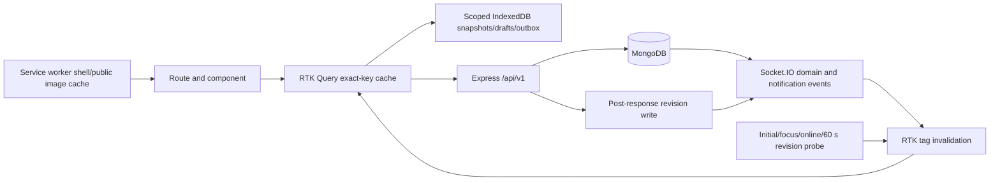

# ECOMSTORE (Smart Kirana) production optimization master plan

**Planning snapshot:** 28 November 2026, Git `0b9a49853b45ae2f843be9d10105492d20eb3eb7`. **Scope:** planning and safe local measurement only. No application source, production data, deployment, or infrastructure was changed. Read together with [the route and role test matrix](ECOMSTORE_ROUTE_ROLE_REGRESSION_PERFORMANCE_MATRIX.md), `ECOMSTORE_AUDIT_SUMMARY.md`, and `ECOMSTORE_COMPLETE_TECHNICAL_AUDIT.md`. Findings below marked **C** are confirmed by source or this run; **M** are measured locally; **H** need representative browser, hosting, or database evidence. The earlier audits are untracked files in this working tree; this plan does not assume they are already part of a release.

## Decision rules and release contract

1. Preserve each route, permission, API response shape, offline capability, and the current visual design. Treat `client/src/App.jsx`, `server/src/routes/index.js`, and the individual route files as the coverage registry. A client guard is never a substitute for server authorization.
2. For each read, distinguish **exact-key cached data**, **first load**, **background revalidation**, **known stale/offline**, **unavailable**, and **confirmed current**. Never show a previous filter's result under a new filter or convert unavailable figures to zero. Keep an existing view mounted during same-key refresh; reserve geometry for uncached data. Preserve route, scroll, filter, and draft state using existing `useSavedViewState`, `SavedScroll`, and cart draft mechanisms where they fit.
3. Keep all financial, stock, order, packing, supplier, and closing mutations server authoritative. Do not optimistically claim a completed write. Keep idempotency keys, version checks, transactions, receipt/ledger reconciliation, and conflict handling. Treat a timeout after submission as **unknown outcome**, then reconcile by durable identifier before retrying.
4. A change proceeds only when its before/after trace, correctness assertions, and rollback are recorded. Use identical fixture sizes, cache state, browser/device/network profiles, and server allocation. Compare median and p95 over repeated runs; show raw samples and confidence limits. A faster median with worse p95 or a correctness regression is not a pass.
5. Roll out in small slices: baseline → startup → page behavior → freshness → cache/offline → API → Mongo → bundle/SW → cleanup → integrity → infrastructure → full QA. A later phase can be measured earlier. Defer deletion until ownership and feature coverage are proven.

## Reproducible baseline and what it does not prove

**Measured locally at this HEAD (M):** `client/npm run build -- --outDir ../tmp/plan-baseline-dist` succeeded; 173 files total, 1,784,200 uncompressed bytes; 161 JavaScript files, 1,619,094 uncompressed bytes. Largest JS files: `PieChart` 345,469 B, entry 254,443 B, vendor 173,000 B, Redux 45,097 B, `ReportsPage` 43,536 B. Wall time was 39.42 s **while both test suites ran concurrently**, so it is not a clean build-time benchmark. `client/npm test -- --reporter=dot`: 36 files/173 tests passed, 36.60 s. `server/npm test -- --reporter=dot`: 3 files/164 tests passed, 103.63 s. The server suite deliberately logs injected failures while testing rollback; its exit code was zero. The prior audit recorded isolated build runs of 10.89 s and 21.35 s; do not compare them as a release speedup or regression. The generated build and logs are under ignored `tmp/`.

`server/npm run perf:smoke -- ../tmp/plan-perf-smoke.json` succeeded against **disposable MongoDB**, 5,000 synthetic products per tenant, 30 warm sequential samples/query, page 24. The **current index set** (the script's `after` state) examined 24 documents and had no blocking sort for `admin_recent`, `counter_catalog`, and `storefront_default`; local query p95 was 2.34, 2.58, and 2.46 ms respectively. The script's `before` state intentionally omits five current catalog indexes and is an experimental comparator, **not a measurement of the deployed app or prior release**. It does not measure count, regex search, price sort, deep paging, API latency, concurrency, or hosting. Preserve the JSON artifact and command in any future comparison.

**Missing baseline (H):** no authenticated production/staging browser waterfall, RUM, API p50/p95/p99, request count/bytes by route and initiator, Web Vitals, IDB open/hydration/write duration, SW installation transfer, Node CPU/heap/event-loop delay, Mongo profiler/explain on representative records, 429/error rate, socket reconnect loss, container throttling/restarts, or verified Northflank/Mongo region and allocation. The earlier audit's 0.2 vCPU/512 MB report is unverified. No production DB or hosting account was accessed. Do not stress-test production or alter real customer data. Use a disposable tenant or staging replica with anonymized representative cardinality; production observability should be read-only and low overhead.

**Repeatable browser protocol:** pin commit, Node/npm lockfiles, device/browser versions, build, tenant fixture, active user/role, network RTT/throughput, CPU throttle, cache/SW/IDB state, time window, and test data. For every matrix route: run cold browser/no SW, warm same-account, exact-key cached, changed filter/page, offline with saved/unsaved data, slow 3G-like network, 429/timeout, online reconnect, and account/tenant switch as applicable. Record `navigationStart → shell visible → useful cached data → fresh confirmed`, LCP/INP/CLS, long tasks, React commits, transfer/request count, and view-state retention; capture 5+ repeats per condition and state the sample count. For writes use disposable fixture IDs and compare response, DB ledger/stock, notification, revision, and duplicate-submit behavior. Record this baseline before changing any code.

## Current data and freshness map

**C:** `main.jsx` awaits `initializeSavedData` before mounting `App`; `AuthInit` separately waits for refresh on protected routes unless an offline identity is valid. `baseApi.js` uses exact-key `currentData`, indefinite unused RTK retention, no automatic focus/reconnect refetch, a 15 s base timeout, and custom 429 handling. `savedData.js` serializes snapshots after business reads, prunes beyond 240 query entries, and probes revisions on startup/focus/online/60 s. `LiveUpdates.jsx` batches socket tag invalidations in 75 ms, including broad reconnect invalidation. `savedDataSync.js` records revisions after a successful response and emits `data:changed`; bespoke order/notification/packing events can overlap. `BroadcastChannel` handles session changes, not business data. `packingOutbox.js` is the only automatic offline write replay. The service worker precaches all emitted build assets and up to 160 public images. `StoreOwnerLayout.jsx` adds payment and packing queue reads; `NotificationBell.jsx` reads unread count and 20 notifications. These are real costs to measure, not established causes of hosted slowness.

**Target contract:** RTK Query owns visible read results keyed by endpoint/args/account scope. IndexedDB is a scoped, bounded persistence layer for explicitly needed offline views and drafts. Socket.IO is the prompt signal for targeted live domains; revision counters provide bounded missed-event recovery after reconnect/focus and for domains without sockets. One event should cause at most one useful revalidation of each **active affected query** after coalescing; closed views stay marked stale and revalidate on next open. A successful server mutation should be the authority for the acting tab and send a durable, ordered change signal to other tabs/users. Before reducing polling or generic revisions, prove there is no gap if a process dies between DB commit, response, revision increment, and socket emit. A revision write made only after `res.finish` is not fully durable recovery for that gap. Evaluate an in-transaction revision/outbox record for critical domains, or another proven durable mechanism, before deleting existing fallback paths. Do not add a new service by default.

### Query and caller inventory for measurement

| Route / read | Exact client caller | Current server work and source | Question to resolve |
|---|---|---|---|
| Public catalog GET `/storefront/:slug/products` | `pages/customer/StoreFront.jsx` → `hooks/useInfiniteProducts.js` → `features/products/productApi.js` | `storefront.controller.js:125-190`: regex filters, category descendant ID read, price-sort aggregate or find/skip/limit plus `countDocuments`; `models/Product.js` indexes | Search/price/deep-page explain and result equivalence; do not infer default-sort smoke covers them. |
| Owner catalog GET `/products` | `pages/store-owner/products/ProductList.jsx`, POS/returns lookups → `productApi.js` | `product.controller.js:42-95`: regex, optional projection/populate, sort/skip/limit and count | Which filters and payloads dominate p95; whether adjacent-page prefetch helps. |
| Inventory GET `/inventory/dashboard`, `/list`, `/ledger/:productId` | `InventoryDashboard.jsx`, `StockLedgerPage.jsx` → `features/inventory/inventoryApi.js` | `inventory.controller.js:19-94,240-246`: product aggregate; regex list plus count; tenant stock ledger page/count | Variants scanned, query plan, ledger depth and stock accuracy. |
| Workspace GET `/dashboard` | `pages/store-owner/Dashboard.jsx`, `pages/staff/Dashboard.jsx` → `dashboardApi.js` | `dashboard.controller.js:37-91,125-193`: parallel order/product/user aggregates, counts and recent orders, role-specific work | Per-stage duration, connection-pool wait, date/settlement consistency. |
| Inbox GET `/notifications`, `/unread-count` | `components/layout/NotificationBell.jsx`, `pages/store-owner/notifications/NotificationsPage.jsx` → `notificationApi.js` | `notification.controller.js:24-33`: scoped `find().sort().skip().limit()` and `countDocuments`; `models/Notification.js` indexes | Bell/list duplicate reads, owner `$or` plan, notification freshness vs bandwidth. |
| Orders GET `/storefront/:slug/admin/orders` and payment queue | `OrdersManagement.jsx`, `OperationalOrdersPage.jsx`, `StoreOwnerLayout.jsx` → `orderApi.js` | `storefront.controller.js:749-811`: cursor or skip/page/count, linked settlement details | Cursor consistency, count cost, layout queue request necessity. |
| Packing GET `/packing/my-orders`, `/admin/queue`, `/admin/activity` | `StaffOrdersPage.jsx`, `PackingVerificationPage.jsx`, `StaffActivityPage.jsx`, `StoreOwnerLayout.jsx` → `packingApi.js` | `packing.controller.js:49-59,477-479,633-684`: assigned order/session reads, list/count and report aggregate | Assignment scope, sort plans, queue updates and duplicate invalidation. |
| Reports GET `/reports/*`, `/daily-closing/*` | `ReportsPage.jsx`, `SalesOverviewPage.jsx`, `ProfitLossPage.jsx`, `DailyClosingPage.jsx` → `features/reports/reportsApi.js`, `dailyClosingApi.js` | `reports.controller.js:66-139,219-499`, `sales.controller.js:32-89`, `dailyClosing.controller.js`: multi-collection aggregates, page/count and business-date rules | Dominant stage, document scans, ledger/closing equality, date boundaries. |
| Platform GET `/super-admin/stats`, `/stores` | `pages/super-admin/{Dashboard,StoresPage}.jsx` → `superAdminApi.js` | `superAdmin.controller.js:19-53`: counts, recent store population, aggregate, skip/count | Platform growth and tenant detail isolation. |
| Backup GET `/backup/*` | `pages/store-owner/backup/BackupPage.jsx` uses direct `fetch` | `backup.controller.js:40-81` and `services/backupRestore.js`: full tenant documents/files, bounded inventory export, restore integrity | Export memory, elapsed time, full backup consistency and private data protection. |

This table identifies query shapes from code; it does **not** assert a slow execution plan on the deployed database. For every row, record the query filter/sort shape, representative cardinality, winning plan, keys/docs examined, response bytes and p95 before changing code. The route matrix supplies the complete page and permission coverage.

## Phase 1 — Performance baseline and instrumentation

- **Problem/root (C/H):** existing tests and build sizes do not measure user speed. Current Express logging is development-only (`server/src/app.js`); request initiators, server timing, Mongo work, cache/IDB cost, and CPU contention are unknown. Prior audit and the local run establish size and correctness baselines, not hosted bottlenecks.
- **Affected:** `client/src/main.jsx`, `client/src/api/baseApi.js`, `client/src/offline/savedData.js`, `client/src/components/layout/{StableRoutes,RouteContent}.jsx`; `server/src/app.js`, `server/src/config/db.js`, controllers for storefront/products/dashboard/reports, `deploy/northflank/{Caddyfile,start.sh}`; POST `/auth/refresh` and GET `/storefront/:slug/products`, `/dashboard`, `/notifications`, `/sync/revision`, `/reports/*`. Retain existing `server/scripts/performance-smoke.js` as a narrow index smoke test.
- **Action/dependencies:** first capture the protocol above. Add lightweight correlation IDs and route-template latency/response-size/DB operation timing in staging; use sampling and omit credentials, payment data, customer names, or raw query strings. Mark shell/hydration and exact-key cache milestones in browser traces. Capture Northflank and Mongo allocation, region, throttling, restarts, pool wait, and explain `executionStats` for representative read-only queries. No new telemetry service is assumed.
- **Tests/risk/acceptance:** verify instrumentation adds no PII, changes no API body or response status, and imposes <2% p95 overhead in a controlled staging comparison (proposed gate). Baseline must include request/bytes, p50/p95/p99, Web Vitals, CPU/RAM, IDB/SW, 429/error and freshness lag for priority workflows. Roll back instrumentation via its feature flag or revert if overhead, data leakage, or cardinality is excessive.

## Phase 2 — Non-blocking application startup

- **Problem/root (C):** `client/src/main.jsx:13-23` renders `StartupShell`, then awaits outbox, logout marker, identity, and snapshot reads in `offline/savedData.js` before React Router/App exists. `AuthInit.jsx` adds refresh gating on protected pages. Blocking IDB on slow/blocked storage delays the first navigable shell; shortening it must not show the wrong tenant's snapshot.
- **Affected/target:** `main.jsx`, `StartupShell`, `AuthInit`, `ProtectedRoute`, `SavedDataGate`, `savedData.js`, `storage.js`, `authSlice.js`, `client/src/app/store.js`; POST `/auth/refresh`, GET `/auth/me`. Render the stable route shell immediately, hydrate scoped state asynchronously, allow public catalog requests while identity resolves, and hold protected sensitive content behind a clear access gate. Show saved scoped data as provisional until refresh confirms it; preserve pending logout semantics.
- **Steps/dependencies:** after Phase 1 timings, separate minimal synchronous shell boot from optional IDB work; make hydration epoch/scope checked and cancellable on sign-in/out; avoid double refresh from StrictMode; use targeted skeletons only where no exact-key data exists. Maintain offline identity's 12 h limit and never use it to authorize writes. Validate failed/blocked IDB and slow refresh independently.
- **Tests/risk/acceptance:** automated cold/warm/offline boot with delayed/rejected IDB, refresh 401/429/timeout, two tabs, account/tenant switch, pending logout, and stale response races. Proposed gate: shell visible without waiting for IDB; no sensitive cross-scope flash; no blank transition; p95 time to useful content improves against matched baseline without increasing 401/429 or request count materially. Roll back to the existing startup gate if isolation cannot be proved.

## Phase 3 — Smooth UI, rendering, and navigation

- **Problem/root (C/H):** route chunks are lazy (`App.jsx`, `routePrefetch.js`), and `StableRoutes` defers location during suspension, but page components still choose their own `isLoading`/`isError` branch. Exact-key `currentData` correctly prevents wrong-filter results yet a new key can display a blank list. `pages/store-owner/notifications/NotificationsPage.jsx` currently renders `meta.total ?? 0` in its heading even if the first inbox read has no result; this must be an unavailable state, not an asserted zero. Audit analogous summary cards. Flicker, CLS, wasted renders, and navigation delay remain unmeasured. `StoreOwnerLayout` queue reads and bell reads run on many pages.
- **Affected/target:** `StableRoutes.jsx`, `RouteContent.jsx`, `SavedReadBoundary.jsx`, `useNavigationPrefetch.js`, `workspaceWarmup.js`, `storefrontWarmup.js`, `useNextPagePrefetch.js`, `useSavedViewState.js`, `SavedScroll`, `NotificationBell.jsx`; page components in `client/src/pages/{customer,store-owner,staff,delivery,super-admin}`. Retain route splitting, existing layouts, exact-key safety, and draft/scroll storage. Keep chrome and headings mounted, reserve list/card/table geometry, update only affected panels, and label a previous view if temporarily shown during a filter transition.
- **Steps/dependencies:** trace priority routes before changing them; inventory each page's loading/error branches; standardize same-key refresh behavior and first-key placeholders; debounce only searches that produce excess requests; use React profiler to fix proven rerender hotspots rather than blanket memoization. Check pointer/focus route warmup and adjacent-page prefetch against actual click probability and constrained network. Preserve forms and filters on back/forward and route changes.
- **Tests/risk/acceptance:** visual and Playwright tests across matrix routes for cached→fresh, changed filters, slow chunks, error recovery, scroll, draft, keyboard/focus, mobile breakpoints. Proposed gates: zero full document navigations inside the SPA; no loss of already visible valid same-key data during refresh; no wrong-key data; CLS <0.1 and INP <200 ms at p75 on agreed test devices, with actual baseline reported first. Roll back component by component if workflow or accessibility regresses.

## Phase 4 — Synchronization architecture simplification

- **Problem/root (C; duplicate magnitude H):** `LiveUpdates.jsx` handles bespoke order/packing/notification events, generic `data:changed`, broad connect invalidation; `savedData.js` probes revisions on auth/focus/online/60 s and retries rejected reads; mutations also invalidate RTK tags. `savedDataSync.js` writes revisions post-response. Multiple paths can target the same active query. Current coalescing prevents some duplication, so none can be removed on source inspection alone.
- **Affected/target:** `client/src/components/shared/{LiveUpdates,SocketProvider}.jsx`, `client/src/offline/{savedData,revisionChanges,packingOutbox}.js`, `client/src/api/{baseApi,workspaceTags}.js`, feature `*Api.js` tag definitions, `server/src/{middleware/savedDataSync.js,services/syncRevision.service.js,utils/changeTags.js,config/socket.js,services/notification.service.js}`, `models/{SyncRevision,Notification,Order,PackingSession}.js`; GET `/sync/revision`, `/storefront/:slug/sync-revision`, `/notifications`, order/packing/delivery/POS/payment mutations.
- **Steps/dependencies:** instrument one event timeline per domain and count active queries refetched per confirmed write. Define a domain→tag→event owner table: order/packing/notification prompt socket, mutation response for actor tab, revision fallback for missed events and non-socket domains (inventory/accounting/catalog/public). Deduplicate by revision/operation ID and query cache key, scope events by tenant/user, and mark dormant entries stale without fetching. Evaluate durable critical revision publication before reducing polling; keep the 60 s fallback until reconnect and crash-window tests prove another mechanism. Keep session `BroadcastChannel` or extend it only with safe account-scoped revision hints.
- **Tests/risk/acceptance:** automated missed socket, reconnect, out-of-order/duplicate event, multi-tab cookie rotation, tenant switch, process death after commit, failed revision write, packing offline replay/409, and notification persistence tests. Proposed gate: one active affected-key refetch per event window in normal operation, no unrelated report/catalog refetch from inbox read, recovery within bounded tested window, and no missed critical updates. Compare request counts and freshness lag on matched traces. Roll back domain by domain to existing invalidation plus revision interval; never remove a fallback before durable recovery passes.

## Phase 5 — Smart caching and offline optimization

- **Problem/root (C):** `baseApi.js` has `keepUnusedDataFor: Infinity`; `savedData.js` prunes above 240 keys and serializes after reads; `storage.js` allows a 20 MiB snapshot. `useSavedViewState.js` writes a whole scope draft object per state change. `SavedDataStatus.jsx:81-109` scans active query timestamps and calls their minimum the "oldest visible snapshot," while its settled normal state says "Showing saved data." That aggregate can confuse users and costs per-render work without locating the stale field. Breadth can consume CPU, heap, and IDB writes; current impact is H. Offline views, cart, and packing outbox are business features.
- **Affected/target:** `offline/{savedData,storage,useSavedViewState,outbox,packingOutbox}.js`, `features/cart/{cartDraftMiddleware,cartDraftStorage,restoreCartDraft}.js`, `api/baseApi.js`, `offline/SavedDataStatus.jsx`, `offlineShellPlugin.js`, `offline/shell.js`. Keep account-scope isolation, guest public-only snapshots, offline identity expiry, saved cart/drafts, explicit pending writes, and conflict resolution. Retain useful revisit data with domain-specific retention derived from route use and cache cost, not a universal short TTL.
- **Steps/dependencies:** measure heap, entry count, snapshot size/serialization/IDB write frequency and offline route hit rate. Choose explicit persisted endpoint/query budget and LRU/recency policy; use incremental or batched writes only if profiling proves savings. Never persist credentials, private payment proofs, unauthorized responses, or old tenant data. Add cache schema migration/eviction behavior. Remove the minimum-timestamp calculation and routine "Showing saved data" text if per-view provenance and last successful server confirmation are in place; retain prominent offline, failed-read, unavailable, stale, storage failure, pending write, and conflict indicators. Show data age at the owning view rather than aggregate optimism.
- **Tests/risk/acceptance:** IDB quota/blocked/versionchange, old schema, sign-out/tenant switch, expired identity, offline visited/unvisited routes, pending packing reconciliation, cart and form recovery, 4xx rejection. Proposed gate: no cross-tenant bytes, no lost confirmed draft/outbox item, no false current labels; reduced IDB write bytes/time and heap on scripted 240-filter browsing while warm revisit remains within agreed route budget. Roll back cache policy/schema via versioned migration that can read prior snapshots; do not delete user drafts/outbox during rollback.

## Phase 6 — API and network optimization

- **Problem/root (C/H):** product/notification lists use read plus count; owner layout and bell add queue/inbox reads. Adjacent-page and hover prefetch may spend bandwidth on unused destinations. `baseApi` timeout is 15 s (selected writes override it); retries and rate-limit cooldown protect requests. No response byte/429/duplicate-call baseline exists. Public visitors share an IP limiter (`rateLimiter.js`).
- **Affected/target:** `client/src/features/{products,orders,notifications,packing,dashboard,reports,storefront}/*Api.js`, `app/{workspaceReadPlan,queryWarmup,backgroundTasks,storefrontWarmup}.js`, `hooks/{useNavigationPrefetch,useNextPagePrefetch}.js`; `server/src/controllers/{product,storefront,notification,dashboard,packing,reports}.controller.js`, `middleware/rateLimiter.js`, `app.js`. Prioritize GET `/products`, `/storefront/:slug/products`, `/dashboard`, `/notifications`, `/packing/admin/queue`, `/storefront/:slug/admin/orders/payment-queue`, `/reports/*`.
- **Steps/dependencies:** classify route waterfall as essential/secondary/speculative; cancel or defer unnecessary speculative reads on slow network; avoid duplicate count/list calls only if contract and totals are preserved; trim projections and payloads; inspect compression headers and image redirects. Treat API contract changes as versioned compatible migrations. Tune rate limits only after 429 and shared-IP tests, keeping abuse controls. Do not add automatic retries for non-idempotent writes.
- **Tests/risk/acceptance:** request/bytes per cold and warm route, p50/p95/p99 API latency, 429 rate, search result equivalence, pagination/count accuracy, no duplicate charge/order on timeout, shared-IP anonymous and business role traffic. Proposed gate: fewer unnecessary requests/bytes at equal data correctness and freshness; no increased successful-workflow 429s. Roll back each endpoint/prefetch change independently, retaining old response fields during migrations.

## Phase 7 — Backend and MongoDB optimization

- **Problem/root (C/H):** `product.controller.js:42-95`, `storefront.controller.js:125-190`, and `inventory.controller.js:83-94` use case-insensitive unanchored regex; storefront price sort computes prices in an aggregation; category descendants load IDs first. `dashboard.controller.js:37-91` runs seven operations; `reports.controller.js` and `sales.controller.js` aggregate growing transaction sets; many lists use `skip` plus count. Current indexes handle three synthetic default sorts well, but representative search/report performance is unknown. Mongo pool is 10 (`config/db.js`).
- **Affected/target:** controllers above plus `notification.controller.js` inbox `$or`, `packing.controller.js` queue/reports, `superAdmin.controller.js` counts/lists, `backup.controller.js` full export; models `Product`, `Order`, `Notification`, `StockLedger`, `PackingSession`, `Expense`, `PurchaseEntry`, `Supplier`, `UdharCustomer`, `DailyClosing`; GET catalog/search/price, `/dashboard`, `/inventory/*`, `/reports/*`, `/notifications`, `/packing/*`, `/super-admin/*`, `/backup/*`. Preserve tenant-first filters, sorting stability, pagination metadata, and exact monetary totals.
- **Steps/dependencies:** collect `explain('executionStats')`, `keysExamined`, `docsExamined`, blocking sort, memory/disk use, and p95 at representative per-tenant cardinalities. Optimize the measured worst query first: bounded search key strategy with semantics tests; price-sort projection/index or a safe maintained field only if needed; targeted compound indexes with write/storage cost measured; cursor pagination where deep skip is proven problematic. Profile report pipeline stages and reuse calculations only after reconciling ledger values. Do not blindly raise pool size or add every plausible index.
- **Tests/risk/acceptance:** result-set/order equivalence including case/diacritics, inactive variants, category descendants, date/time zone boundaries, empty and deep pages; concurrent stock/financial mutations alongside reads; index migration and query-plan checks. Proposed gate: dominant queries meet staging p95 budget agreed from baseline, no collection scan/blocking sort where an indexed route is expected, stable API result/ledger totals, no unacceptable write slowdown or index storage growth. Roll back query code and optional indexes with a controlled migration; never drop an old index until new plan is verified.

## Phase 8 — Frontend bundle, service worker, and assets

- **Problem/root (C/M):** `client/offlineShellPlugin.js:5-27` precaches every emitted asset; local JS is 1.62 MB before compression, with 345 KB `PieChart` chunk. Caddy already gives fingerprinted assets long immutable caching and gzip/zstd. `routePrefetch.js`, workspace/storefront warmups and SW precache can download routes a user never opens. Actual transferred bytes and SW install duration are H.
- **Affected/target:** `client/vite.config.js`, `offlineShellPlugin.js`, `src/offline/shell.js`, `App.jsx`, `app/{routePrefetch,workspaceWarmup,storefrontWarmup}.js`, `pages/store-owner/reports/{ReportsPage,SalesOverviewPage}.jsx`, image components, `deploy/northflank/Caddyfile`. Retain lazy routes, current offline paths that users rely on, ImageKit/public image behavior, and versioned SW cleanup.
- **Steps/dependencies:** record compressed transfer, parse/execute time, SW install and offline hit matrix. Build a minimal versioned shell precache and on-demand route-chunk cache; explicitly designate required offline routes after product sign-off/usage evidence. Audit chart import boundaries and use chart code only where visible. Review responsive image dimensions, lazy loading, format and cache headers without exposing private proofs. Test SW update/activation while tabs and drafts are open.
- **Tests/risk/acceptance:** offline route matrix on first install and after visiting each route, update with two tabs, bad asset response, quota, old SW, customer and workspace shell, image privacy; bundle diff and first-visit request/bytes/CPU. Proposed gate: lower first-install transfer and install time, no missing designated offline screen, no blank page after version update, no CLS from media. Roll back to previous precache manifest/SW version while keeping prior caches readable; avoid forced `skipWaiting` during an active sale.

## Phase 9 — Dead code, duplicate logic, and dependency cleanup

- **Problem/root (H):** 463 files under client/server/deploy/docs and short optimization/revert history make dead code plausible, but source inventory alone cannot prove a component or endpoint unused. Some duplication across order events, saved-data invalidation, route prefetch mapping, and API tags is confirmed structurally; whether it is redundant must be shown by coverage.
- **Affected/target:** `App.jsx` and `app/routePrefetch.js` route maps, `api/workspaceTags.js`, feature API invalidation declarations, `LiveUpdates.jsx`, `offline/savedData.js`, package manifests/locks, server route/controller exports, deploy scripts. Retain `packingOutbox` and other offline code until actual use and recovery needs are established. The 26 November reverted hosting changes are not current code.
- **Steps/dependencies:** after phases 2–8, create static import/route/endpoint usage inventory, search dynamic imports and externally consumed API routes, compare bundle and runtime traces, then remove one verified unused unit at a time. Replace duplicated freshness mapping only after Phase 4 domain tests. Check lockfile/license/security updates in a separate controlled change; no framework replacement.
- **Tests/risk/acceptance:** build, unit/integration/E2E matrix, offline and role-gated route smoke, external API contract checks. Proposed gate: every deletion has an explicit unused proof and a smaller bundle or simpler ownership graph; no missing route/event/backup export. Roll back each isolated removal if runtime or client compatibility fails.

## Phase 10 — Reliability, security, and financial integrity

- **Problem/root (C/H):** critical flows already use transactions and tests, but performance changes can widen races or hide a failed write. Checkout notification persistence/rollback, POS Udhar, supplier allocation, stock ledger, daily closing versions, and packing operation receipts are protected paths. `savedDataSync.js` revision after response has a commit-to-publication gap; 15 s client timeout can leave an unknown result. Live incident rates are unknown.
- **Affected/target:** `server/src/controllers/{storefront,pos,purchase,return,inventory,udhar,supplier,expense,salary,dailyClosing,packing,delivery}.controller.js`, `utils/transaction.js`, `models/{Order,StockLedger,UdharEntry,DailyClosing,PackingSession,Notification}.js`, authorization middleware, `client/src/hooks/useIdempotentSubmission.js`, `baseApi.js`, `offline/packingOutbox.js`; corresponding POST/PATCH routes. Retain role/permission and tenant checks, server pricing/stock authority, audit trail, idempotency, version validation, and no silent offline financial posting.
- **Steps/dependencies:** formalize invariants for every mutation (sum of payment legs, due balances, stock nonnegative/ledger match, one order/receipt per idempotency key, frozen finalized closing with audited corrections). Test transaction retries, process death, network timeout after commit, concurrent actors, changed assignments, and replay. Make revision/notification publication durable for critical changes before simplifying sync. Audit backups and restore readiness (`backupRestore.js`, `backup.controller.js`) against isolated recovery drills.
- **Tests/risk/acceptance:** expand existing `server/test/api.security.test.js` failure injection and concurrency tests, client 409/429/unknown-outcome tests, tenant/permission matrix, backup restore verification. Proposed gate: invariants hold under concurrent staging workload and fault injection; no cross-tenant read/write; no duplicate financial/stock posting; recovery gives the same authoritative state. Roll back the optimization immediately on invariant failure; keep data migrations reversible and reconcile affected disposable records before release.

## Phase 11 — Hosting and infrastructure optimization

- **Problem/root (C/H):** one Northflank container runs Caddy and Node (`deploy/northflank/{Dockerfile,start.sh,Caddyfile}`); Mongo is external; Node starts listening only after DB, restore readiness and four model inits (`server/server.js`); pool max 10. Current plan, region, CPU throttling, restarts, RTT, and replica count are unverified. Caddy already compresses and sets cache headers. In-process rate-limit state would not be shared across replicas.
- **Affected/target:** deployment files above, `server/src/config/{db,readiness,env}.js`, `server/server.js`, `server/src/middleware/rateLimiter.js`, `/health`, `/ready`, Socket.IO transport. Keep loopback proxy trust, private uploads, graceful shutdown, restore gate, and readiness semantics.
- **Steps/dependencies:** retrieve actual allocation/regions and staging resource trace. Co-locate app and DB region if RTT proves material; adjust container memory/CPU or deployment sleep behavior only from observed contention; tune DB pool within connection limits. Check graceful termination with active socket, pending revision work, and in-flight transaction. Consider multi-replica Socket.IO/rate-limit coordination only if scaling is justified; do not assume one-container semantics survive horizontal scaling.
- **Tests/risk/acceptance:** cold start, DB outage/recovery, readiness during deploy, SIGTERM drain, websocket/polling reconnect, 1/5/10/25/50 staging users, CPU/heap/event-loop/connection metrics, and public-IP header validation. Proposed gate: no premature ready response, no dropped committed mutation or missed durable change on restart, stable p95 under the agreed client load, no 429 spike. Roll back deployment configuration/image atomically; preserve compatible DB schema and cached frontend assets.

## Phase 12 — Complete QA, load testing, and client handover

- **Problem/root:** passing 337 local tests is meaningful but does not cover all 50+ route variants, real browsers, offline upgrades, load, or client operations. The attached matrix is the execution ledger, with roles and performance conditions.
- **Affected/target:** `client/e2e/{auth,responsive-accessibility,ui-polish}.spec.js`, `client/e2e-isolated/`, Vitest suites, `server/test/{api.security,productSpreadsheet,deployment-config}.test.js`, `server/scripts/performance-smoke.js`, `deploy/northflank/README.md`, `docs/`, runbooks. Preserve all workflows and UI except approved loading/status refinements.
- **Steps/dependencies:** execute the matrix on representative staging, mobile and desktop, with disposable tenants and accounts. Run repeated browser traces and safe staged 1/5/10/25/50-user read/write mixes; compare p50/p95/p99, throughput, 429/5xx, CPU/RAM, Mongo connections/explain, notification freshness, IDB and SW. Reconcile ledger/stock/closing totals before and after. Produce a handover packet: architecture/freshness rules, permissions, backup/restore drill, deploy/rollback, alert thresholds, environment variables, known limits, measured baseline and after evidence, accessibility results, incident playbook.
- **Tests/risk/acceptance:** no high-severity unresolved regression, all role/tenant/integrity gates passed, agreed performance budgets met on named infrastructure, offline matrix passed for designated coverage, restore drill succeeded, and client operator can execute deployment/rollback and observe failures. Avoid publishing or deploying until review. Roll back the release to the previous compatible image and SW manifest if any critical gate fails; do not restore production DB from a benchmark fixture.

## Cross-phase measurement ledger and go/no-go gates

| Metric | Baseline here | Capture before implementation | Compare after / proposed gate |
|---|---:|---|---|
| Build output | 1,784,200 B total; 1,619,094 B JS uncompressed | compressed transfer and parse time by route | lower first-visit transfer without loss of offline coverage |
| Local correctness | 173/173 client; 164/164 server | same commands plus matrix failures | all pass; no finance/stock/tenant regression |
| Synthetic indexed catalog | 24 docs examined; p95 2.34–2.58 ms for three warm finds | search, counts, price sort, deep page and representative explain | improve measured slow queries without changing results |
| Shell/useful/fresh time | unknown | cold/warm, IDB delayed, offline by role | shell independent of IDB; matched p95 improves |
| Requests/bytes per route | unknown | HAR by initiator/cache state | active affected query fetched once/event window; fewer speculative reads |
| API and hosted resource | unknown | p50/p95/p99, 429/5xx, CPU/RAM, loop delay, pool wait | budget agreed from real baseline; no higher errors |
| Freshness and correctness | unknown | event→visible update, reconnect lag, ledger/stock totals | bounded recovery; exact-key UI; invariant equality |
| Web Vitals | unknown | p75 LCP/INP/CLS on named devices | target INP <200 ms, CLS <0.1; LCP budget agreed after baseline |

Numerical gates above are **proposals**, not achieved results or claims that every route currently fails them. Record per-phase before/after raw evidence and decision in a versioned benchmark note. If staging differs materially from production, explicitly mark the result as staging only.

## Missing access and unresolved decisions

- Production/staging Northflank settings, logs, metrics, Mongo plan/region/volume, real user traffic mix, and authenticated route traces are unavailable in this workspace. Request read-only access or exported redacted traces when implementation begins; do not infer free-tier limits from old notes.
- Decide with the client which **never-visited** workspace routes must work offline before reducing SW precache. Today every built chunk is installed, while business data still requires a prior fetch. This is a product coverage decision, not just a bundle optimization.
- Confirm whether offline packing is used operationally and its acceptable reconciliation delay. Keep the current outbox until evidence and a replacement contract exist.
- Agree performance budgets for target devices, network and concurrent users only after baseline. The proposed thresholds in this document are gates to negotiate, not measured SLA commitments.
- Confirm external API consumers, if any, before response-shape or endpoint removal. The repository does not prove there are none.
- Resolve the tension between immediate protected shell rendering and confidentiality: the shell may render immediately, but tenant-specific content must wait for a verified scope or a valid scoped offline identity, and offline data must be labelled provisional.
